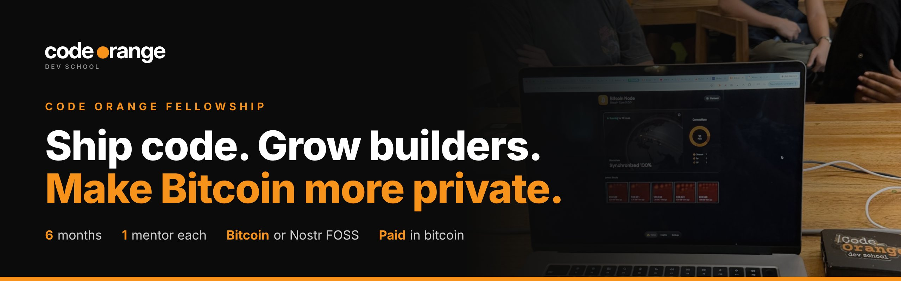
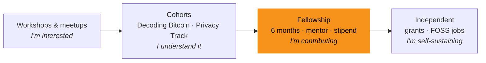

  

  
  
  

  
  
  

# Code Orange Fellowship

**Get paid to build Bitcoin and Nostr open source, with a mentor, for 6 months.**

Code Orange runs workshops, cohorts and meetups that turn curious Bitcoiners into contributors. The fellowship is the next step: pick a project, get a mentor and a stipend in bitcoin, and build a public track record.

| | Developer Track | Educator Track |
|---|---|---|
| **You are** | A dev ready to contribute to Bitcoin or Nostr FOSS | Someone who wants to teach Bitcoin development in your community |
| **You do** | Write and review code, open PRs, work with a mentor | Run cohorts and workshops, create materials, grow your local scene |
| **You get** | $512/month in bitcoin + a mentor | $256/month in bitcoin + curriculum + event support |
| **Time** | 10-15 h/week, 6 months | 8-12 h/week, 6 months |
| **Start here** | [Guidelines](developer-fellowship/GUIDELINES.md) · [Track page](developer-fellowship/) | [Track page](educator-fellowship/) · [Playbook](educator-fellowship/facilitation-playbook.md) |
| **Apply** | [codeorange.dev/fellowships/apply](https://codeorange.dev/fellowships/apply) | Proposal to **hello@codeorange.dev** ([template](templates/education-proposal.md)) |

> **Applications are rolling.** Seats are limited by how many mentors we have, not by how many people apply. We reply within 2 weeks.

---

## Find your path

| I am... | Read this first |
|---|---|
| 🧑‍💻 **Thinking about applying** | [Guidelines](developer-fellowship/GUIDELINES.md) → [Project menu](developer-fellowship/project-menu.md) → [Readiness check + apply](https://codeorange.dev/fellowships/apply) |
| 🟠 **A current fellow** | Your [fellow dashboard](https://codeorange.dev/fellowships/me) (link in your welcome email) · [Monthly report template](templates/monthly-report.md) · [Payment and reporting](shared/payment-and-reporting.md) |
| 🧭 **A maintainer or experienced contributor** | [Become a mentor](#become-a-mentor) |
| 🏫 **Running a similar program** | [Operating system](OPERATING_SYSTEM.md) · [Evaluation rubric](shared/evaluation-rubric.md) · Everything is CC0, fork it |
| ❓ **Just curious** | [FAQ](shared/faq.md) |

---

## The path

Many developers who finish a study cohort stop before they become regular contributors, because the first months of open-source work are slow and unpaid. The fellowship pays for that stretch. The goal at graduation is a public record strong enough to win independent funding or a FOSS job.

---

## How it works

| When | What happens |
|---|---|
| **Before you apply** | Do the learning, open at least one PR or real review on your project, write a 6-month plan |
| **Apply** | Readiness check + form at [codeorange.dev/fellowships/apply](https://codeorange.dev/fellowships/apply). Short call, 20-minute PR walkthrough, reference check |
| **Month 1** | Meet your mentor, lock the plan, first PR in |
| **Every week** | Monday check-in on your dashboard, mentor call, at least one review of someone else's PR |
| **Every month** | Short report on your dashboard (it is also your invoice). Highlights go on your public proof-of-work page |
| **Month 2, 4, 6** | Present your work at [Code Review Club](https://github.com/code-orange-dev/code-orange-dev/blob/main/privacy-contributor-program/REVIEW_CLUB.md) |
| **Month 3** | Mid-point review: continue, adjust or stop ([rubric](shared/evaluation-rubric.md)) |
| **Month 6** | Final demo, hand-off notes, grant application drafted with our help |

**What is public and what is not:** your GitHub work, monthly highlights and milestones are public on your proof-of-work page. Applications, contact details and payments are always private and never go in this repo.

---

## Projects

Any Bitcoin or Nostr open-source project works. Privacy and wallet infrastructure is our sweet spot. Full list with difficulty ratings: **[project menu](developer-fellowship/project-menu.md)**.

| Area | Projects |
|---|---|
| **Privacy** | [rust-payjoin](https://github.com/payjoin/rust-payjoin) · [rust-silentpayments](https://github.com/cygnet3/rust-silentpayments) · [OpenSwap](https://github.com/citadel-foss/openswap) · [JoinMarket](https://github.com/JoinMarket-Org/joinmarket-clientserver) · [Fedimint](https://github.com/fedimint/fedimint) |
| **Nodes & light clients** | [Floresta](https://github.com/Davidson-Souza/Floresta) · [Kyoto](https://github.com/rustaceanrob/kyoto) · [Bitcoin Core](https://github.com/bitcoin/bitcoin) |
| **Wallets & payments** | [BDK](https://github.com/bitcoindevkit/bdk) · [BTCPay Server](https://github.com/btcpayserver/btcpayserver) · [LDK](https://github.com/lightningdevkit/rust-lightning) · [rust-bitcoin](https://github.com/rust-bitcoin/rust-bitcoin) |
| **Nostr** | [rust-nostr](https://github.com/rust-nostr/nostr) · [NDK](https://github.com/nostr-dev-kit/ndk) · [nostr-tools](https://github.com/nbd-wtf/nostr-tools) · [NIPs](https://github.com/nostr-protocol/nips) |

Something else? If it is Bitcoin or Nostr and open source, propose it.

---

## Become a mentor

Every fellow needs a mentor before they start, so **mentors are what unlock new seats**.

- **Who:** an active contributor or maintainer of a Bitcoin or Nostr project.
- **Ask:** a 30-60 minute call each week with your fellow and timely feedback on their PRs, for the length of the fellowship.
- **What you get:** a prepared, motivated contributor on your project, and a say in who we accept.

Interested? [Open a mentor issue](https://github.com/code-orange-dev/fellowships/issues/new?template=mentor-interest.yml) or email **hello@codeorange.dev**.

---

## Fellows

Current fellows and their public proof of work are listed at **[codeorange.dev/fellowships](https://codeorange.dev/fellowships)**. Each fellow has a page that pulls their PRs and reviews live from GitHub.

---

## Every document

<b>Developer track</b>

| | |
|---|---|
| [Guidelines & expectations](developer-fellowship/GUIDELINES.md) | The bar, the rhythm, pay and accountability, on one page |
| [Track overview](developer-fellowship/) | Who it's for, the six-month arc |
| [Detailed spec](developer-fellowship/README-DETAIL.md) | Milestones, what good looks like, renewal |
| [Project menu](developer-fellowship/project-menu.md) | Suggested codebases, difficulty-rated |
| [One-pager](developer-fellowship/ONE-PAGER.md) ([PDF](developer-fellowship/developer-fellowship-one-pager.pdf)) | The whole deal on one page |
| [Application questions](developer-fellowship/application.md) | What the form asks, so you can prepare |
| [Proposal template](templates/developer-proposal.md) | The 6-month work plan |
| [Monthly report template](developer-fellowship/monthly-report-template.md) | What goes in the monthly report |

<b>Educator track</b>

| | |
|---|---|
| [Track overview](educator-fellowship/) | Pick your format |
| [Detailed spec](educator-fellowship/README-DETAIL.md) | Credit table, caps and floors, tiers, renewal |
| [Facilitation playbook](educator-fellowship/facilitation-playbook.md) | Running a session when you are not the expert in the room |
| [One-pager](educator-fellowship/ONE-PAGER.md) ([PDF](educator-fellowship/educator-fellowship-one-pager.pdf)) | The whole deal on one page |
| [Application](educator-fellowship/application.md) | The form |
| [Proposal template](templates/education-proposal.md) | The 6-month plan |
| [Session log template](educator-fellowship/session-log-template.md) | Log within 48 hours |
| [Monthly report template](educator-fellowship/monthly-report-template.md) | What goes in the monthly report |

<b>Both tracks</b>

| | |
|---|---|
| [Evaluation rubric](shared/evaluation-rubric.md) | How fellows are assessed at month 3 and month 6 |
| [Payment and reporting](shared/payment-and-reporting.md) | Stipends, rails, short months, pausing |
| [FAQ](shared/faq.md) | The questions people actually ask |
| [Operating system](OPERATING_SYSTEM.md) | How the program itself is run |
| [Fellowship agreement](templates/fellowship-agreement.md) | The agreement template |

---

## Programs we learned from

We studied what works elsewhere. Credit where it is due:
[Btrust Builders](https://blog.btrust.tech/introducing-the-2026-btrust-builders-program/) (proof-of-work records) ·
[Chaincode Labs](https://chaincode.com/) / [BOSS](https://learning.chaincode.com/) (structured progression) ·
[Bitshala](https://bitshala.org/cohorts/) (cohorts as community) ·
[Vinteum](https://vinteum.org/) (regional residency) ·
[Summer of Bitcoin](https://www.summerofbitcoin.org/) (mentor matching) ·
[Base58](https://base58.school/) (practical teaching).

Run a program like this and want to compare notes? [Open an issue](https://github.com/code-orange-dev/fellowships/issues/new?template=compare-notes.yml).

## Contributing and license

Fixes, translations and better explanations are welcome: see [CONTRIBUTING.md](CONTRIBUTING.md). Everything here is [CC0](LICENSE). Take it, adapt it, build your own fellowship in your own community.

---

<a href="https://codeorange.dev">codeorange.dev</a> · <a href="https://github.com/code-orange-dev">github.com/code-orange-dev</a> · <a href="https://discord.gg/xd6dmPF9bA">Discord</a>

